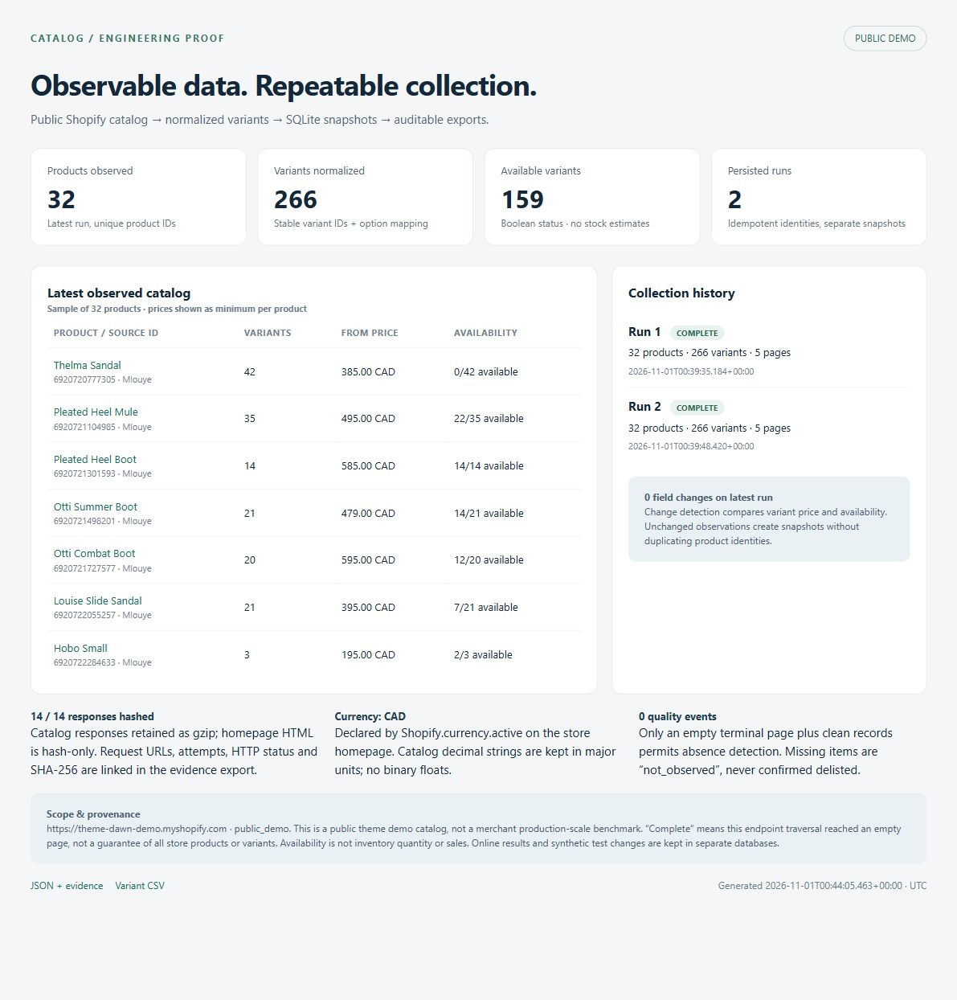

# Shopify Catalog Proof

A small, runnable Python proof for the Shopify ingestion part of an ad-intelligence product. Collects a public catalog, normalizes product/variant records, retains repeatable SQLite observations, and exports a one-page report with evidence. Standard library only; no API key, browser session, login, or third-party dependency is needed.

## Verified demonstration

Two actual HTTPS collections of **https://theme-dawn-demo.myshopify.com** on **2026-11-01, 08:39 China Standard Time (UTC+8)** produced:

| Evidence | Result |
| --- | ---: |
| Endpoint traversal status | Both complete |
| Unique product identities | 32 |
| Variants per run | 266 |
| Available variants in latest run | 159 |
| Product snapshots across two runs | 64 |
| Catalog pages per run | 5 (4 nonempty + empty terminal page) |
| HTTP requests across two runs | 14, all HTTP 200 |
| SHA-256 response summaries | 14 |
| Retained raw catalog/robots responses | 12 gzip files |
| Duplicate product identities after repeat | 0 |
| Price / availability changes observed | 0 |
| Quality events | 0 |

This is an actual network capture of a **public theme demonstration store**. It is not a real-merchant or production-scale benchmark. Synthetic price/availability changes are in `evidence/synthetic/` only and never mixed into the live database. The two live runs were seconds apart and demonstrate repeatability, not long-term monitoring.



## Start here

Requires Python 3.11+ (verified on Windows with Python 3.14.6). Extract the ZIP, open a terminal in this folder, then:

```powershell
python catalog.py serve
```

Open **http://127.0.0.1:8765/report.html**. The shipped report already contains the actual results. You can also open `exports/report.html` directly without running a server. The server binds to loopback only and serves the exports directory; it has no write endpoints. Stop with Ctrl+C.

To reproduce into a **new database**, leaving the shipped proof intact:

```powershell
python catalog.py collect --db work/reproduction/catalog.sqlite --limit 10 --delay 1 --network direct
python catalog.py collect --db work/reproduction/catalog.sqlite --limit 10 --delay 1 --network direct
python catalog.py report --db work/reproduction/catalog.sqlite --output work/reproduction/exports
python catalog.py export --db work/reproduction/catalog.sqlite --output work/reproduction/exports
```

Collection exit code: **0 = complete; 2 = partial or failed**. A CLI argument/configuration error is also nonzero. Always inspect the returned JSON status and error field rather than inferring success from the presence of output files. Future online counts may differ from the shipped capture.

`--network direct` bypasses environment proxies **for this client's opener only**. `--network env` honors the process proxy environment. Neither changes system/global network settings. `--store` accepts an HTTPS origin; other stores default to `public_store` provenance. Use `--source-kind public_demo` explicitly for other demonstration stores. No access protection is bypassed.

## Data and failure semantics

- Identity is `(store origin, product ID)`; variant IDs are preserved as strings within each product. Each run has one normalized snapshot per valid product, a content SHA-256, provenance, and UTC timestamps. Current identities are upserted; snapshots are not discarded.
- NFKC Unicode normalization and whitespace cleanup are applied to text. HTML descriptions become plain text; script/style bodies are removed. Options are mapped from their numeric positions rather than array order. Invalid amounts, missing identifiers, invalid availability, duplicate variant IDs, and inconsistent option mappings reject the entire product and log a quality event.
- `price` / `compare_at_price` use `Decimal`, stored/exported as strings in **major currency units from `/products.json`**. The documented `/products/{handle}.js` endpoint has different money conventions; this collector does not interchange those formats. Prices are never converted to binary floats or silently rounded. CSV guards untrusted leading formula characters; JSON preserves canonical text.
- Currency comes from `Shopify.currency.active` in a separately fetched homepage and includes its source URL. This is a store declaration associated with the run, not a currency field supplied by the catalog endpoint. If unavailable, currency is null/blank and a quality event explains why. No USD default is assumed. Amount change events are suppressed across differing/unknown currencies.
- `available` is a public boolean only. No inventory quantity, units sold, revenue, or ad metrics are inferred. Source product URLs and absolute image URLs are preserved; images are not downloaded.
- Each run fetches and evaluates robots.txt, identifies as `CatalogProof/1.0`, uses a default one-second request interval, and honors a robots crawl delay when present. Defaults: 30-second request timeout, two retries after the first attempt, bounded exponential backoff for connection errors, 429, and selected transient 5xx responses. 401/403 are not retried. Numeric Retry-After is respected up to 60 seconds; longer or date-form pauses stop the run for a later retry. Challenges, invalid JSON/schema, repeated nonempty pages and safety page limits stop traversal explicitly.
- A short nonempty page is **not** treated as the end. Completion requires an empty terminal page and no rejected/duplicate records. `complete` means a clean traversal of this public endpoint **at that moment**, not an authoritative full-store inventory. The public catalog is not an official stable full-catalog API, and paging is not transactionally consistent while a store changes.
- Only a complete traversal permits previously seen but absent products to become `not_observed`. That means missing from this endpoint traversal, **never confirmed delisted**. Partial/failed runs cannot alter the absence state of unobserved products. Successfully observed records from a partial run still get snapshots and current updates. A returning product becomes `observed` again.
- Price, compare-at price, and availability events compare matching variant IDs. Currency changes are separate events. Added/removed variants and other metadata changes remain inspectable in snapshots; they are not emitted as standalone field events in this proof.
- Requests retain URL, attempt, HTTP status, timing, byte size, SHA-256 and error. Catalog/robots response bytes are gzip-compressed in `data/raw`; hashes apply to the decompressed bytes. Homepage HTML is **not retained** to avoid packaging ephemeral storefront/browser tokens; its byte count/hash and the extracted currency source remain. Paths in request logs are relative to the database's parent directory. No cookies, response headers, credentials, or authenticated browser session are persisted.

Run one collector process per database. An abrupt process kill may leave a run marked `running`; already committed observations remain available and absence detection has not run. This compact proof intentionally has no scheduler, distributed workers, storefront/API fallback, or authenticated inventory integration.

## Tests and offline audit

```powershell
python -m unittest discover -s tests -v
python verify_evidence.py
python examples/synthetic_scenario.py --output work/my-synthetic-demo
```

The 22 tests use only synthetic fixtures and mock HTTP responses, in isolated temporary workspace databases. They cover repeat collection, exact decimal changes, equivalent decimal formatting, currency changes/unknown currency, option position mapping, bad/duplicate products and variants, foreign product references, CSV formula guards, report escaping, page limits/repetition/failure, robots denial, HTTP retry/evidence hashing, and partial collection safety.

The synthetic scenario performs four no-network runs: baseline, identical repeat, injected price/availability change, and an injected page-2 timeout with a missing product. Its assertions check exactly two change events and that the unobserved product's state stays `observed` after the partial traversal. The checked-in synthetic artifact has `source_kind=synthetic_fixture` and a `.test` source origin. Choose a fresh output directory when rerunning; the script refuses to overwrite an existing database.

`verify_evidence.py` audits the shipped live capture offline: SQLite integrity/foreign keys, response and content hashes, counts, identical identity sets across the repeat, CSV uniqueness, and export/database agreement. It expects this specific unchanged demonstration and is not a general validator for arbitrary changing stores. `evidence/verification.json` records the result; `evidence/tests.txt` records the test run.

## Files

```text
catalog.py                       Collection / normalization / storage / export / report CLI
tests/test_catalog.py            Synthetic regression tests
examples/synthetic_scenario.py   No-network change/failure demonstration
verify_evidence.py               Offline audit of shipped live capture
data/catalog.sqlite             Actual public-demo runs, snapshots, changes and logs
data/raw/*.gz                    Actual catalog/robots response bytes
exports/report.html             One-page English report
exports/catalog.json            Canonical current catalog, run/request/quality/change logs
exports/variants.csv             One row per current variant, with provenance
evidence/live-report.jpg         Actual browser screenshot of the report
evidence/verification.json       Offline live-evidence audit
evidence/tests.txt               Synthetic regression test output
evidence/synthetic/              Explicitly separate no-network fixture evidence
UPWORK_PROOF.md                  Short technical proof text and recording outline
MANIFEST.sha256                  File checksums for this delivery
```

SQLite tables: `runs`, `products`, `snapshots`, `changes`, `requests`, `quality`. JSON and CSV are current-state exports; SQLite retains full per-run normalized snapshots. `collected_at` is the originating run's UTC start time; per-response timestamps are in `requests`. A `not_observed` current row retains its last observed data and last-seen provenance, rather than inventing fresh data.

## References and boundaries

- [Shopify Ajax Product API](https://shopify.dev/docs/api/ajax/reference/product): documented single-product interface; distinct from the public catalog used here. A successful public endpoint traversal is not proof of unlimited variant/catalog coverage.
- [Shopify crawler identification guidance](https://shopify.dev/changelog/posts/bots-and-agents-should-identify-themselves-via-web-bot-auth): this proof sends a descriptive User-Agent; it does not implement Web Bot Auth or claim authenticated bot identity.
- [Shopify access scopes](https://shopify.dev/docs/api/usage/access-scopes): authorized API access is a separate integration; public availability is not precise inventory.

For an authorized production integration, the next work would be explicit store/API coverage, operational concurrency controls, scheduling, metrics/alerts and retention policies. This delivery proves one Shopify data path only; it does not claim Meta/TikTok scraping or a finished ad-spy SaaS. No Upwork proposal has been submitted.
